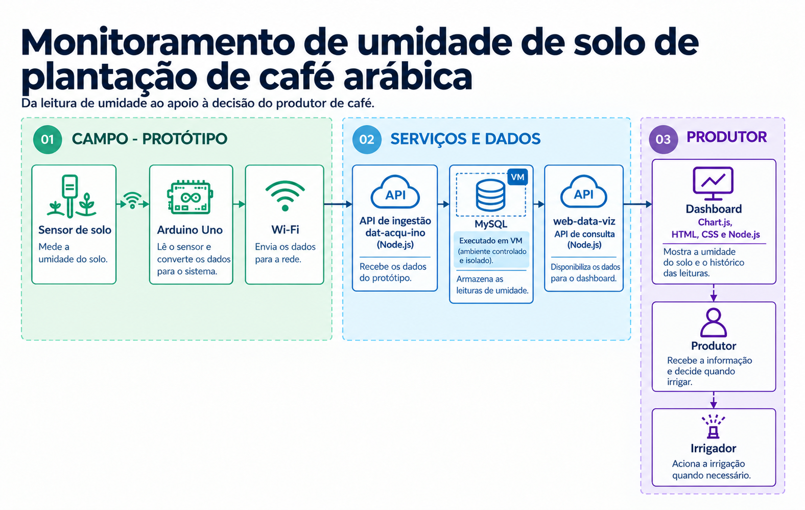
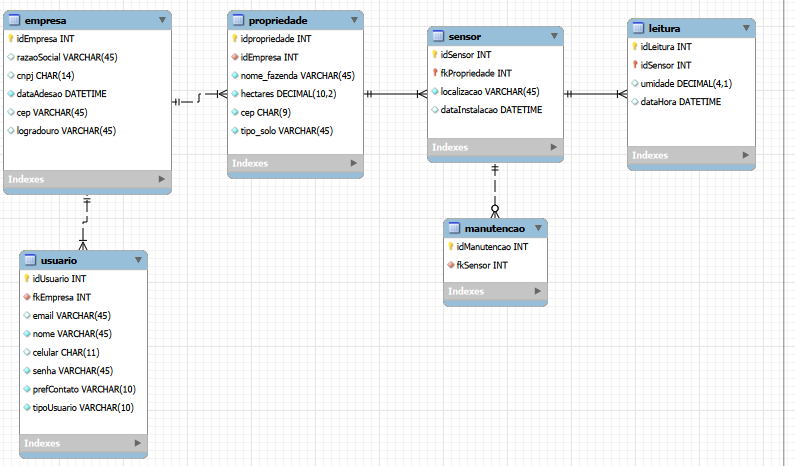
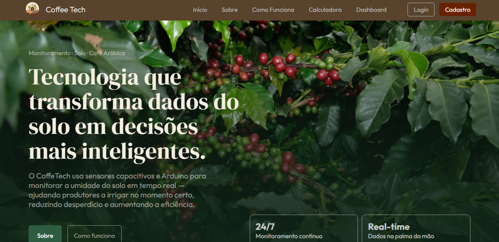
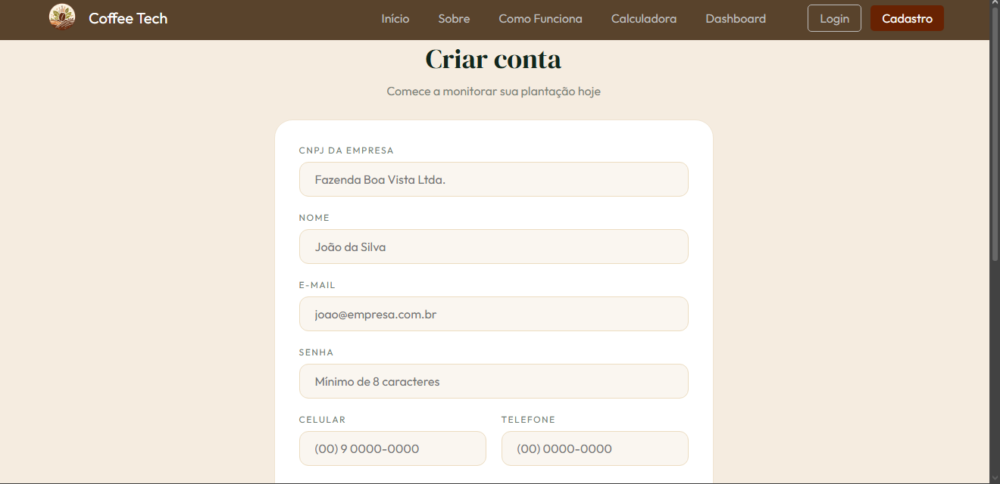
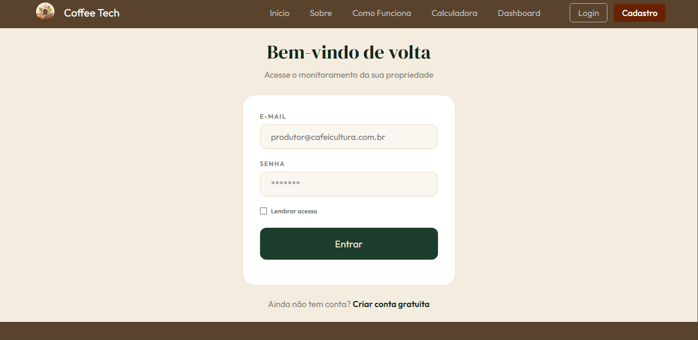
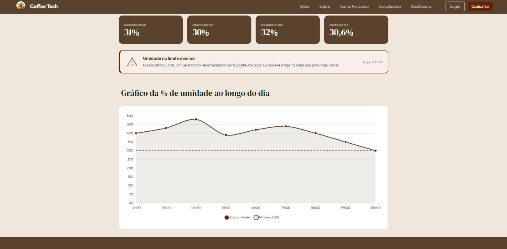
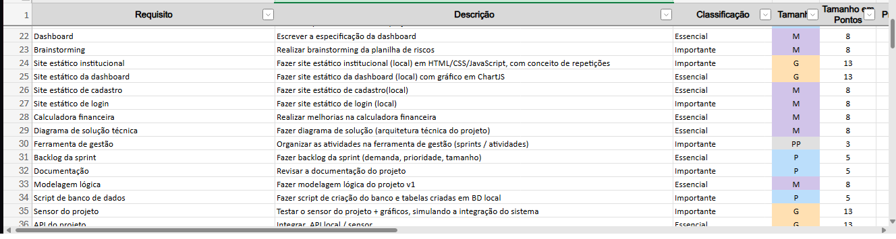
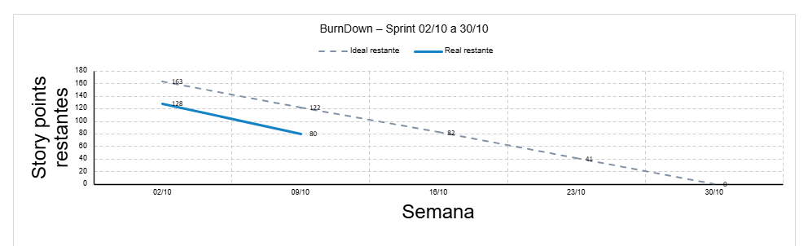
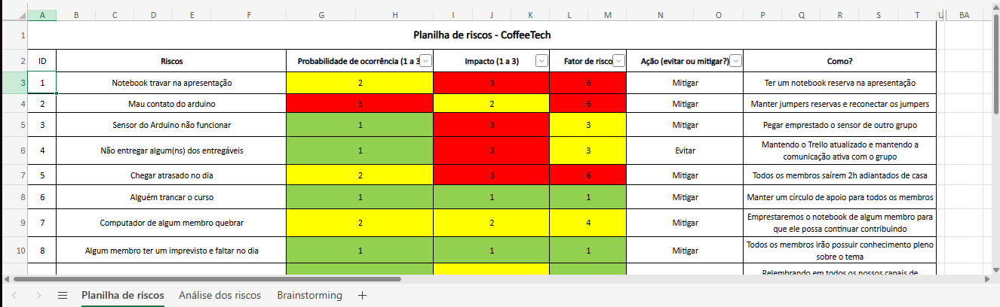

# ☕ CoffeeTech — Sistema de Monitoramento de Solo para Cafeicultura

**Projeto de Inovação (PI) · 1º Semestre de Análise e Desenvolvimento de Sistemas (ADS)**

**Faculdade:** SPTech (São Paulo Tech School)

---

## 📑 Sumário

- [Sobre o projeto](#-sobre-o-projeto)
- [Funcionalidades](#-funcionalidades)
- [Tecnologias e hardware](#️-tecnologias-e-hardware)
- [Escopo do protótipo](#-escopo-do-protótipo)
- [Arquitetura da solução](#-arquitetura-da-solução)
- [Entregáveis](#-entregáveis)
- [Progresso dos entregáveis](#-progresso-dos-entregáveis)
- [Integrantes](#-integrantes)

---

## 🎯 Sobre o projeto

O agronegócio é fundamental para a economia brasileira, e o café Arábica possui grande relevância no setor. Contudo, a falta de dados precisos sobre a umidade do solo faz com que muitos produtores tomem decisões baseadas em observações empíricas, gerando **desperdício de água e energia** ou **perdas por déficit hídrico**, que podem reduzir a produção entre 20% e 30%.

A solução proposta é um **sistema IoT de baixo custo** para monitoramento em tempo real da umidade do solo em lavouras de café. Com base nos dados coletados, o produtor pode tomar decisões mais assertivas de irrigação, preservando a produção e melhorando a qualidade da colheita.

---

## 🚀 Funcionalidades

| # | Funcionalidade | Descrição |
|---|----------------|-----------|
| 1 | 📡 Leitura de umidade | Coleta contínua da umidade do solo por meio de sensor capacitivo. |
| 2 | 🌐 Envio de dados via API | Transmissão automática das leituras utilizando módulo Wi-Fi (ESP8266). |
| 3 | 📊 Dashboard web | Visualização clara e em tempo real dos níveis de umidade do solo. |
| 4 | 💡 Apoio à decisão | Informações para o produtor saber o momento ideal de irrigar ou suspender a água. |

---

## 🛠️ Tecnologias e hardware

### Hardware

- Microcontrolador Arduino Uno R3
- Sensor de umidade de solo capacitivo
- Módulo Wi-Fi ESP8266
- Protoboard e jumpers

### Software

- C / C++ (IDE Arduino)
- APIs para recebimento e disponibilização dos dados
- Dashboard web
- Banco de dados no MySQL Workbench

---

## 📦 Escopo do protótipo

O sistema faz a leitura analógica do sensor, converte os dados em porcentagem de umidade, envia para o banco de dados via API e exibe as métricas no painel web do produtor.

---

## 🧩 Arquitetura da solução

<strong>🧩 Diagrama da solução</strong>

 

---

## 📦 Entregáveis

> 💡 Clique em cada item para expandir.

| Entregável | Link |
|------------|------|
| 📄 Documentação | [Abrir](https://bandteccom-my.sharepoint.com/:w:/g/personal/julia_bsantos_sptech_school/IQBOTKKde-VrRLdML1pMiimxAZ4IKQYrDErZ1yde8GPFSow?e=cbqTyH) |
| 🗄️ DER (Diagrama Entidade-Relacionamento) | _em breve_ |
| 📊 Especificação da dashboard | [Abrir](https://bandteccom-my.sharepoint.com/:w:/r/personal/julia_bsantos_sptech_school/_layouts/15/Doc.aspx?sourcedoc=%7B923F4B97-125E-4FCC-A8B3-AAC5A4EF4964%7D&file=Grupo4_EspecificacaoDashboard.docx&action=default&mobileredirect=true) |
| 📋 Backlog | [Abrir](https://bandteccom-my.sharepoint.com/:x:/r/personal/julia_bsantos_sptech_school/_layouts/15/Doc.aspx?sourcedoc=%7B1BACAEBC-3D99-4B11-A0DB-67F4AA72C580%7D&file=Product_Backlog_coffeTech.xlsx&action=default&mobileredirect=true) |
| 📉 Gráfico de burndown | [Abrir](https://bandteccom-my.sharepoint.com/:x:/r/personal/julia_bsantos_sptech_school/_layouts/15/Doc.aspx?sourcedoc=%7B8C98FE28-C8DB-410E-8A25-8AFF6DB7EA6B%7D&file=Planilha%20dos%20riscos.xlsx&action=default&mobileredirect=true) |
| 🌐 Site estático / Dashboard | _em breve_ |
| 💰 Simulador financeiro | _em breve_ |
| 📽️ Apresentação | _em breve_ |

<strong>📄 Documentação</strong>

 

🔗 **Link:** [Abrir documentação](https://bandteccom-my.sharepoint.com/:w:/g/personal/julia_bsantos_sptech_school/IQBOTKKde-VrRLdML1pMiimxAZ4IKQYrDErZ1yde8GPFSow?e=cbqTyH)

<strong>🗄️ DER (Diagrama Entidade-Relacionamento)</strong>

 

<strong>📊 Especificação da dashboard</strong>

 

🔗 **Link:** [Abrir especificação da dashboard](https://bandteccom-my.sharepoint.com/:w:/r/personal/julia_bsantos_sptech_school/_layouts/15/Doc.aspx?sourcedoc=%7B923F4B97-125E-4FCC-A8B3-AAC5A4EF4964%7D&file=Grupo4_EspecificacaoDashboard.docx&action=default&mobileredirect=true)

<strong>🌐 Site estático</strong>

 

**Página inicial**

**Cadastro**

**Login**

<strong>📈 Dashboard</strong>

 

<strong>📋 Backlog</strong>

 

🔗 **Link:** [Abrir backlog](https://bandteccom-my.sharepoint.com/:x:/r/personal/julia_bsantos_sptech_school/_layouts/15/Doc.aspx?sourcedoc=%7B1BACAEBC-3D99-4B11-A0DB-67F4AA72C580%7D&file=Product_Backlog_coffeTech.xlsx&action=default&mobileredirect=true)

<strong>📉 Gráfico de burndown</strong>

 

🔗 **Link:** [Abrir gráfico de burndown](https://bandteccom-my.sharepoint.com/:x:/r/personal/julia_bsantos_sptech_school/_layouts/15/Doc.aspx?sourcedoc=%7B8C98FE28-C8DB-410E-8A25-8AFF6DB7EA6B%7D&file=Planilha%20dos%20riscos.xlsx&action=default&mobileredirect=true)

<strong>⚠️ Planilha de risco</strong>

 

🔗 **Link:** [Abrir planilha de riscos](https://bandteccom-my.sharepoint.com/:x:/r/personal/julia_bsantos_sptech_school/_layouts/15/Doc.aspx?sourcedoc=%7B8C98FE28-C8DB-410E-8A25-8AFF6DB7EA6B%7D&file=Planilha%20dos%20riscos.xlsx&action=default&mobileredirect=true)

<strong>💰 Simulador financeiro</strong>

 

_em breve_

<strong>📽️ Apresentação</strong>

 

_em breve_

---

## 📊 Progresso dos entregáveis

| Entregável | Progresso |
|------------|-----------|
| Contexto | `▰▰▰▰▰▰▰▰▰▰ 100%` |
| Protótipo do site | `▰▰▰▰▰▰▰▰▰▰ 100%` |
| Banco de dados | `▰▰▰▰▰▰▰▰▰▰ 100%` |
| Simulador financeiro | `▰▰▰▰▰▰▰▰▰▱ 90%` |
| Documentação | `▰▰▰▰▰▰▰▰▰▰ 100%` |
| Site final | `▰▰▰▰▰▰▰▰▰▱ 90%` |
| Apresentação | `▱▱▱▱▱▱▱▱▱▱ 0%` |

> O **progresso geral** é a média simples dos 7 entregáveis: `▰▰▰▰▰▰▰▰▱▱ 80%`

---

## 👥 Integrantes

**Grupo 04 · Turma 1ADSA · 7 integrantes**

| # | Nome | GitHub |
|---|------|--------|
| 1 | Arthur Lima dos Santos | [@Arthurfull](https://github.com/Arthurfull) |
| 2 | Bruno Volpe Costa | [@bruno-volpe915](https://github.com/bruno-volpe915) |
| 3 | Guilherme de Sousa Pinheiro | [@guisyntax](https://github.com/guisyntax) |
| 4 | Matheus de Souza Menino | [@MatheusMenino](https://github.com/MatheusMenino) |
| 5 | Julia Carolina Brito dos Santos | [@caju1911](https://github.com/caju1911) |
| 6 | Nátaly Rufino Pereira Gutierrez | [@nataly1802](https://github.com/nataly1802) |
| 7 | Vinícius Augusto Alves de Almeida | [@Vinicius-Augusto05](https://github.com/Vinicius-Augusto05) |

---

Feito com ☕ pelo **Grupo 04** da turma **1ADSA** · [Voltar ao topo](#-coffeetech--sistema-de-monitoramento-de-solo-para-cafeicultura)